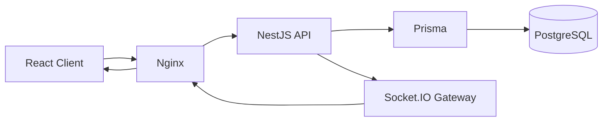
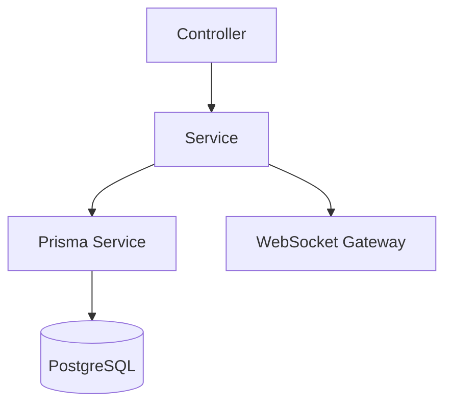
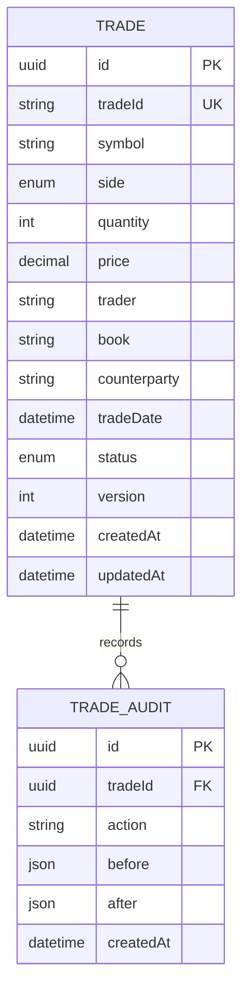
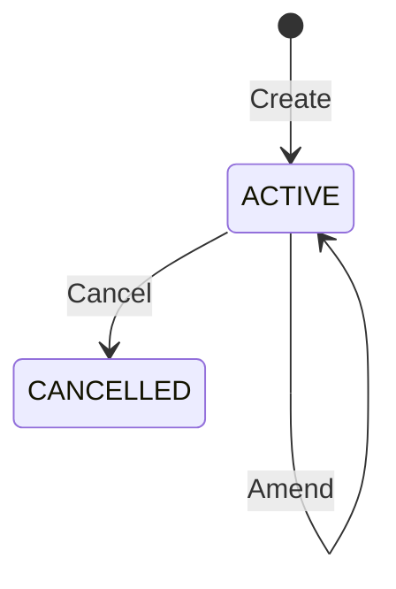
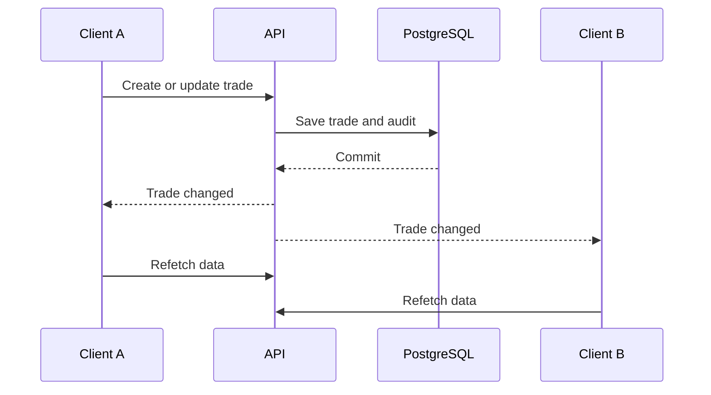

# Fusion Trading Workspace — Architecture

## 1. Overview

A full-stack equity trade blotter designed for simplicity, maintainability, data consistency, and real-time synchronization.

This application is a technical assessment prototype using synthetic trade data.

## 2. System Architecture

PostgreSQL is the source of truth. REST APIs handle trade operations, while Socket.IO notifies connected clients of changes.

## 3. Frontend

Built with React, TypeScript, and Vite.

- TanStack Query — server state and caching
- TanStack Table — filtering, sorting, and pagination
- React Hook Form and Zod — forms and validation
- Socket.IO Client — real-time synchronization
- Reusable components and feature-based utilities

## 4. Backend

Built with NestJS using a modular architecture.

- Controllers handle HTTP requests.
- DTOs validate incoming data.
- Services handle business rules and transactions.
- Prisma manages database access.
- WebSocket gateways broadcast trade changes.

## 5. Data Model

Trade changes and audit records are saved within the same database transaction.

## 6. Trade Lifecycle

- Trades are created with an active status.
- Active trades can be amended or cancelled.
- Cancelled trades cannot be modified.
- Cancellation preserves records and audit history.

## 7. Concurrency Handling

Optimistic locking prevents concurrent users from overwriting each other's changes.

Each trade has a version number that increments after a successful update.

If the submitted version is outdated:

- The API returns HTTP 409 Conflict.
- The frontend retrieves the latest record.
- Non-conflicting changes can be merged.
- Conflicting fields require user confirmation.

## 8. Real-Time Synchronization

Events are published after a successful database commit. Clients refetch data rather than treating WebSocket messages as authoritative records.

Reconnection also triggers a data refresh.

## 9. Key Design Decisions

| Decision | Reason |
| --- | --- |
| Modular monolith | Simpler development and deployment |
| PostgreSQL | Reliable relational persistence |
| Optimistic locking | Prevent lost updates |
| Database transactions | Maintain trade and audit consistency |
| WebSocket notifications | Synchronize connected clients |
| Server-side pagination | Limit data transferred to clients |
| Soft cancellation | Preserve trade history |
| Decimal storage and BigInt calculations | Improve financial precision |
| Docker Compose | Reproducible local environment |

## 10. Security

Implemented safeguards:

- Client and server-side validation
- DTO field whitelisting
- Restricted CORS origins
- Parameterized database queries
- Security headers
- Non-root backend container
- CSV formula-injection protection

Authentication and authorization are outside the assessment scope. The application is intended for trusted local use only.

## 11. Deployment

Docker Compose manages three services:

- Frontend — React and Nginx
- Backend — NestJS
- Database — PostgreSQL

Database migrations and seed data are initialized automatically. Database records persist across container restarts.

## 12. Testing

| Area | Passing Tests |
| --- | ---: |
| Backend | 96 |
| Frontend | 150 |
| Total | 246 |

Tests cover validation, trade operations, concurrency, audit history, financial calculations, conflict resolution, and API error handling.

Production builds passed, and npm audits reported zero vulnerabilities on November 24, 2026.

Final browser regression and hot-reload verification remain pending.

## 13. Future Improvements

- Authentication and role-based access control
- Distributed WebSocket infrastructure
- Transactional outbox and idempotency
- End-to-end decimal precision
- Database integration and end-to-end testing
- Monitoring and observability
- Rate limiting
- Database backup and recovery
